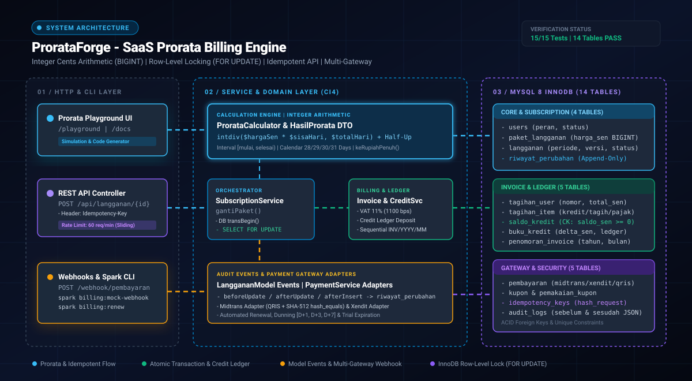

# ProrataForge

> Mesin penagihan langganan (*subscription billing*) dan kalkulasi prorata berbasis CodeIgniter 4.5+ dan PHP 8.3+.
>
> Menangani perubahan paket tengah periode (*upgrade* dan *downgrade*), buku besar saldo kredit (*credit ledger*), penerbitan faktur atomik, serta integrasi gateway pembayaran menggunakan aritmatika integer sen (`BIGINT`).

<p>
<a href="https://codeigniter.com"></a>
<a href="https://www.php.net"></a>
<a href="https://www.mysql.com"></a>
<a href="https://phpunit.de"></a>
<a href="LICENSE"></a>
</p>

## Arsitektur Sistem

<p align="center">  </p>

| **Komponen Arsitektur** | **Mekanisme Teknis** | **Jaminan Integritas Data** | 
| **Aritmatika Integer Sen** | Seluruh nilai moneter disimpan sebagai `BIGINT` dalam satuan sen (`Rp150.000 = 15000000 sen`) dan dihitung menggunakan `intdiv()` dengan pembulatan *half-up*. | Mengeliminasi *floating-point representation error* (`0.1 + 0.2 !== 0.3`) pada seluruh rantai kalkulasi. | 
| **Konkurensi & Idempotensi** | Eksekusi perubahan paket mengunci baris via `SELECT ... FOR UPDATE` dan memvalidasi header `Idempotency-Key` dengan sidik jari payload SHA-256. | Mencegah *race condition* pada kuota/saldo kredit dan menolak duplikasi faktur akibat *network retry*. | 
| **Gateway & Audit Trail** | Mendukung verifikasi webhook waktu-konstan (`hash_equals`) serta pencatatan histori *append-only* melalui CodeIgniter 4 *Model Events*. | Menjamin kesesuaian nilai transaksi pembayaran dengan catatan buku besar dan rekaman jejak audit. | 

## Spesifikasi Teknis

* **Aritmatika Integer Sen**: Seluruh nominal uang disimpan dan dikalkulasi dalam satuan terkecil (sen integer) menggunakan pembagian integer *half-up*. Tipe data `float` tidak digunakan dalam perhitungan tagihan.

* **Simulator Interaktif Prorata (`/playground`)**: Antarmuka pengujian untuk memvisualisasikan proporsi hari terpakai terhadap sisa hari, rincian kredit/tagihan, serta generator potongan kode (*cURL, JavaScript, PHP, Python*).

* **Manajemen Siklus Hidup Langganan**:

  * **Upgrade**: Menagih selisih biaya untuk sisa hari dalam periode berjalan dan mengaktifkan paket baru secara langsung.

  * **Downgrade**: Mengonversi selisih kelebihan pembayaran paket lama menjadi saldo deposit kredit pelanggan (*credit ledger*) yang otomatis memotong tagihan periode berikutnya.

* **Faktur Sekuensial & Cetak**: Penerbitan nomor faktur berurutan (`INV/YYYY/MM/000001`) dengan penguncian baris tabel penomoran, pemotongan deposit kredit otomatis, kalkulasi PPN 11% (`1100` basis poin), penyesuaian pembulatan rupiah penuh, dan tampilan cetak A4/PDF.

* **Multi-Gateway Payment Adapter**:

  * **Midtrans**: Integrasi QRIS dan verifikasi tanda tangan SHA-512 menggunakan `hash_equals()`.

  * **Xendit**: Pembuatan faktur pembayaran dan validasi token callback.

  * **Adapter Factory Pattern**: Abstraksi antarmuka gateway untuk memudahkan penambahan penyedia layanan pembayaran baru.

* **Perangkat CLI (`php spark`)**:

  * `php spark billing:mock-webhook [ORDER_ID]` — Simulasi pengiriman callback pelunasan lokal tanpa *tunneling* eksternal (ngrok).

  * `php spark billing:renew` — Pembuatan faktur perpanjangan otomatis untuk langganan yang mendekati akhir periode.

  * `php spark billing:dunning` & `php spark billing:expire` — Pengiriman pengingat tagihan jatuh tempo bertingkat (H+1, H+3, H+7) dan penonaktifan langganan kedaluwarsa.

* **Kontrol Keamanan & Konkurensi**: Kewajiban header `Idempotency-Key` pada endpoint mutasi, pembatasan laju permintaan (*sliding window rate limit* 60 request/menit), dan transaksi database atomik lintas tabel.

## Konvensi Perhitungan Prorata

ProrataForge menerapkan konvensi interval setengah-terbuka `[tanggal_mulai, tanggal_selesai)` dengan normalisasi waktu ke pukul `00:00:00 UTC`. Perkalian dilakukan terlebih dahulu sebelum pembagian integer untuk menghindari akumulasi selisih pembulatan harian:

```
total_hari    = selesai - mulai                          (mengikuti jumlah hari kalender: 28, 29, 30, atau 31)
hari_terpakai = tgl_ubah - mulai                         (dinormalkan ke pukul 00:00:00 UTC)
sisa_hari     = total_hari - hari_terpakai

kredit_sen    = half_up((harga_lama_sen * sisa_hari) / total_hari)
tagihan_sen   = half_up((harga_baru_sen * sisa_hari) / total_hari)
bersih_sen    = tagihan_sen - kredit_sen

```

### Matriks Kasus Uji Kalkulator (`ProrataCalculator`)

| **Kasus** | **Skenario Transisi** | **Rentang Periode & Tanggal Efektif** | **Sisa / Total Hari** | **Kredit Paket Lama** | **Tagihan Paket Baru** | **Tagihan Bersih (Pra-PPN)** | 
| **Kasus A** | Upgrade Basic (`Rp90.000`) ke Pro (`Rp150.000`) | 1 Apr – 1 Mei (Efektif 11 Apr) | 20 / 30 hari | `Rp60.000,00` | `Rp100.000,00` | **`Rp40.000,00`** | 
| **Kasus B** | Upgrade Tahun Kabisat (`Rp290.000` ke `Rp580.000`) | 1 Feb – 1 Mar 2024 (Efektif 15 Feb) | 15 / 29 hari | `Rp150.000,00` | `Rp300.000,00` | **`Rp150.000,00`** | 
| **Kasus E** | Downgrade Bisnis (`Rp300.000`) ke Basic (`Rp100.000`) | 1 Okt – 1 Nov (Efektif 11 Okt) | 21 / 31 hari | `Rp203.225,81` | `Rp67.741,94` | **`-Rp135.483,87`** (Saldo Kredit) | 
| **Kasus F** | Harga Ganjil (`Rp99.999` ke `Rp149.999`) | 1 Apr – 1 Mei (Efektif 11 Apr) | 20 / 30 hari | `Rp66.666,00` | `Rp99.999,33` | **`Rp33.333,33`** | 
| **Kasus H** | Februari Non-Kabisat (`Rp280.000` ke `Rp560.000`) | 1 Feb – 1 Mar 2026 (Efektif 15 Feb) | 14 / 28 hari | `Rp140.000,00` | `Rp280.000,00` | **`Rp140.000,00`** | 

## Alur Eksekusi Transaksi (`SubscriptionService::gantiPaket`)

Proses pergantian paket dieksekusi dalam satu transaksi database terisolasi:

```
[ Request: POST /api/langganan/{id}/ganti-paket ]
          |
          v
1. Validasi Header Idempotency-Key & Format Tanggal (YYYY-MM-DD)
          |
          v
$db->transBegin();
          |
          +--> 2. Periksa tabel idempotency_keys (user_id + endpoint + kunci)
          |       +--> Jika ditemukan & hash cocok: Kembalikan respons JSON tersimpan
          |       +--> Jika ditemukan & hash berbeda: Tolak dengan HTTP 409 Conflict
          |
          +--> 3. SELECT * FROM langganan WHERE id = ? FOR UPDATE;
          |       +--> Kunci baris langganan & verifikasi kepemilikan (user_id)
          |
          +--> 4. Ambil harga_sen paket lama & baru dari tabel paket_langganan di server
          |       +--> Kalkulasi diskon kupon (jika disertakan) sebelum prorata
          |
          +--> 5. Eksekusi ProrataCalculator::hitung() -> HasilProrata DTO
          |
          +--> 6. InvoiceService::buatInvoiceProrata() & CreditService
          |       +--> Bersih < 0 (Downgrade): Tambah saldo_kredit + catat di buku_kredit
          |       +--> Bersih > 0 (Upgrade): Potong saldo_kredit (FOR UPDATE) + PPN 11% + Pembulatan
          |
          +--> 7. Perbarui paket_id & inkremen versi (+1) melalui LanggananModel
          |       +--> Model Events (beforeUpdate & afterUpdate) mencatat riwayat_perubahan
          |
          +--> 8. Simpan hash_request (SHA-256) & respons_json ke tabel idempotency_keys
          |
$db->transCommit(); --> [ Lepas Kunci Baris & Antrekan Notifikasi Email ]

```

## Struktur Direktori

```
prorataforge/
├── assets/
│   └── architecture.svg                         # Diagram arsitektur sistem (SVG)
├── app/
│   ├── Config/
│   │   ├── Billing.php                          # Konfigurasi PPN 1100 bps, dunning, & masa tenggang
│   │   ├── Filters.php                          # Konfigurasi AuthFilter, AdminFilter, ThrottleFilter
│   │   └── Routes.php                           # Definisi rute Web, Playground, REST API, & Webhook
│   ├── Controllers/
│   │   ├── Home.php & PlaygroundController.php  # Dashboard & simulator prorata (/playground)
│   │   ├── LanggananController.php              # Pengelolaan langganan antarmuka web
│   │   ├── TagihanController.php                # Daftar & tampilan cetak faktur A4/PDF
│   │   └── Api/
│   │       ├── LanggananApiController.php       # Endpoint simulasi & gantiPaket()
│   │       ├── TagihanApiController.php         # Endpoint detail faktur & inisiasi pembayaran
│   │       └── WebhookController.php            # Penerima callback Midtrans & Xendit
│   ├── Services/
│   │   ├── HasilProrata.php                     # Readonly DTO hasil perhitungan prorata
│   │   ├── ProrataCalculator.php                # Kalkulator prorata integer sen & half-up rounding
│   │   ├── SubscriptionService.php              # Orkestrator transaksi langganan & row locking
│   │   ├── InvoiceService.php                   # Pembuatan faktur sekuensial, kupon, & PPN 11%
│   │   ├── CreditService.php                    # Pengelolaan saldo kredit & buku besar (ledger)
│   │   ├── PaymentService.php                   # Adapter gateway pembayaran (Midtrans & Xendit)
│   │   └── NotificationService.php              # Antrean pengiriman email pasca-commit
│   ├── Models/
│   │   ├── LanggananModel.php                   # Model langganan & callback Model Events
│   │   ├── RiwayatPerubahanModel.php            # Model log perubahan langganan (append-only)
│   │   └── ...                                  # Model entitas pendukung lainnya
│   ├── Commands/
│   │   ├── RenewalCommand.php                   # Command php spark billing:renew
│   │   ├── MockWebhookCommand.php               # Command php spark billing:mock-webhook [ORDER_ID]
│   │   └── DunningCommand.php & ExpireCommand   # Command penagihan tunggakan & kadaluwarsa
│   └── Helpers/
│       └── uang_helper.php                      # Fungsi formatRupiah() & formatRupiahPenuh()
├── public/
│   └── prorataforge-postman-collection.json     # Dokumentasi koleksi request Postman
├── tests/
│   ├── unit/ProrataCalculatorTest.php           # Unit test kalkulator prorata
│   ├── unit/SubscriptionServiceTest.php         # Unit test transaksi & mutasi saldo kredit
│   └── feature/GantiPaketApiTest.php            # Feature test endpoint REST API & idempotensi
├── docker-compose.yml                           # Konfigurasi kontainer layanan (App + MySQL 8)
└── README.md                                    # Dokumentasi teknis repositori

```

## Menjalankan via Docker

Prasyarat: [Docker Desktop](https://www.google.com/search?q=https%3A%2F%2Fwww.docker.com%2F) atau Docker Engine telah terpasang.

```
# 1. Clone repositori
git clone https://github.com/lilabshor/prorataforge.git
cd prorataforge

# 2. Jalankan kontainer (aplikasi + database MySQL otomatis dibuat & dimigrasi)
docker compose up -d

```

Layanan dapat diakses melalui **`http://localhost:8080`** dan simulator interaktif pada **`http://localhost:8080/playground`**.

## Instalasi Manual (Lokal)

### Prasyarat Sistem

* **PHP 8.2 atau 8.3+** (`ext-intl`, `ext-mbstring`, `ext-mysqli`, `ext-curl`, `ext-openssl`)

* **MySQL 8.0+** (InnoDB Engine dengan dukungan `utf8mb4`)

* **Composer 2.x**

### Langkah Konfigurasi

```
# 1. Pasang dependensi Composer
composer install

# 2. Salin berkas konfigurasi environment
cp env .env

# Sesuaikan parameter koneksi database pada berkas .env:
# database.default.hostname = localhost
# database.default.database = prorataforge
# database.default.username = root
# database.default.password = password_anda

# 3. Jalankan migrasi tabel dan seeder data awal
php spark migrate --all
php spark db:seed BillingSeeder

# 4. Jalankan server pengembangan lokal
php spark serve --host 0.0.0.0 --port 8080

```

## Pengujian (Testing)

Jalankan rangkaian pengujian unit dan fitur menggunakan PHPUnit:

```
./vendor/bin/phpunit --no-coverage

```

Output pengujian:

```
PHPUnit 10.5.66 by Sebastian Bergmann and contributors.

...............                                                   15 / 15 (100%)

Time: 00:00.024, Memory: 14.00 MB

OK (15 tests, 26 assertions)

```

### Matriks Verifikasi Keamanan & Konkurensi

| **Kode Uji** | **Skenario Pengujian** | **Implementasi Mitigasi** | **Status** | 
| **FT-19 / PT-10** | **Idempotency Replay** | Mencocokkan kunci dan hash SHA-256 pada tabel `idempotency_keys`; mengembalikan respons awal tanpa duplikasi faktur. | **PASS** | 
| **FT-20** | **Konflik Payload Idempotensi** | Mengembalikan status `HTTP 409 Conflict` apabila kunci yang sama dikirimkan dengan parameter paket berbeda. | **PASS** | 
| **FT-22 / PT-13** | **Race Condition Langganan & Kredit** | Mengunci baris `langganan` dan `saldo_kredit` dengan `SELECT ... FOR UPDATE` selama transaksi berlangsung. | **PASS** | 
| **PT-01 & PT-02** | **IDOR & Manipulasi Harga** | Identitas pengguna diambil dari sesi server; harga diambil dari tabel `paket_langganan` tanpa menerima input harga dari klien. | **PASS** | 
| **PT-07 & PT-08** | **Verifikasi Webhook Pembayaran** | Memvalidasi signature SHA-512 dengan `hash_equals()` dan memverifikasi kesesuaian nilai `jumlah_sen` terhadap faktur. | **PASS** | 

## Dokumentasi REST API

Dokumentasi spesifikasi endpoint dan koleksi pengujian tersedia pada:

* **Simulator Interaktif**: `http://localhost:8080/playground`

* **Dokumentasi Web**: `http://localhost:8080/docs`

* **Koleksi Postman**: `public/prorataforge-postman-collection.json`

| **Method** | **Endpoint** | **Header Wajib** | **Deskripsi** | 
| `POST` | `/api/kalkulator/simulasi` | `Content-Type: application/json` | Menghitung simulasi prorata tanpa melakukan perubahan pada database. | 
| `POST` | `/api/langganan/{id}/ganti-paket` | `Idempotency-Key: <UUID>` | Mengeksekusi pergantian paket, menerbitkan faktur prorata, atau mencatat saldo kredit. | 
| `GET` | `/api/tagihan/{id}` | Session / Bearer Auth | Mengambil rincian faktur beserta baris item prorata, potongan kredit, dan PPN. | 
| `POST` | `/api/tagihan/{id}/bayar` | Session / Bearer Auth | Menginisiasi sesi pembayaran ke gateway (QRIS Midtrans / Invoice Xendit). | 
| `POST` | `/webhook/pembayaran` | Gateway Signature | Menerima callback status transaksi dari gateway pembayaran. | 

## Lisensi

Didistribusikan di bawah lisensi open-source [MIT License](https://www.google.com/search?q=LICENSE).
